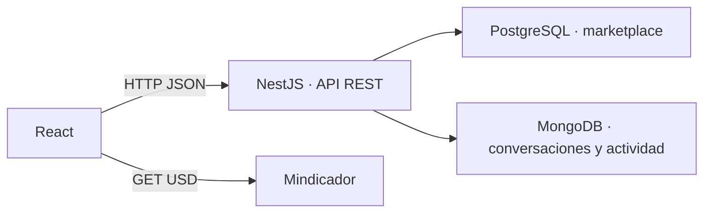

# NexusTech Campus Marketplace · Hito 3

Proyecto académico de Desarrollo Web y Móvil, UNAB Viña del Mar. Caso 3.4: marketplace universitario para publicar, encontrar y comprar de forma simulada equipamiento tecnológico usado. Una cuenta tiene perfil de comprador y de vendedor.

**Equipo:** Andrés Olguín, Miguel Margas Cerpa, Enrique Chamys y Benjamín Aguilera.

El Taller 2 aportó el catálogo, los formularios y el diseño adaptable en React. En el Hito 3, publicaciones, categorías, cuentas, favoritos, carrito y pedidos pasan a una API NestJS y PostgreSQL. Las consultas al vendedor y el historial de actividad se guardan en MongoDB. El catálogo de **240 fichas de muestra** se puede abrir aparte; esas fichas no se agregan al carrito ni se mezclan con las publicaciones de PostgreSQL.

## Ejecutar

Requiere Node.js 22.12 o posterior y Docker Desktop con contenedores Linux. Desde la carpeta que contiene `compose.yaml`:

```powershell
node scripts/hito3-env.cjs
docker compose -p nexustech-hito3-final up -d --build --wait --wait-timeout 240
node scripts/hito3-demo.cjs
```

- Web: [http://localhost:5173](http://localhost:5173)
- Swagger: [http://localhost:3001/docs](http://localhost:3001/docs)
- Estado de las bases: [http://localhost:3001/api/v1/health/ready](http://localhost:3001/api/v1/health/ready)

El primer comando crea `.env` si falta. El tercero carga cuatro publicaciones ficticias por la API y deja las dos cuentas en `.demo-local.json`. Ambos archivos tienen datos locales y quedan excluidos de Git. Ver [paso a paso para Windows](DOCKER.md).

## Diseño y datos



- **React 19, Vite 7, Bootstrap 5:** catálogo paginado, filtros técnicos según tipo, fichas navegables, edición rápida de precios y estados de carga, error y vacío.
- **NestJS 11, TypeORM, PostgreSQL 16:** modelo relacional con restricciones, permisos de propietario y transacción de compra que valida stock y conserva el precio histórico. Los filtros y el orden se aplican antes de paginar. La ficha técnica se guarda junto a la publicación.
- **MongoDB 7:** documentos de mensajes e historial. El servidor verifica participantes. Una cola de salida en PostgreSQL permite reintentar el envío de eventos a MongoDB sin duplicarlos. La compra no depende de una transacción entre motores.
- **Swagger/OpenAPI:** consultar `GET /api/v1/products`, `GET /api/v1/products/facets` o `GET /api/v1/health/ready`. Las rutas de cuenta, carrito, compra e interacciones requieren el token obtenido al iniciar sesión.
- **API pública:** [Mindicador](https://mindicador.cl), `GET https://mindicador.cl/api/dolar`, desde React. Sirve para comparar precios en USD sin usar claves. Si falla, el catálogo sigue en CLP y se informa cuándo se obtuvo la última referencia disponible. La compra se registra en CLP.

[Guía de cierre, demostración y defensa del 16/11](docs/hito3/CIERRE_Y_DEFENSA_2026-11-16.md) · [Decisiones, modelo SQL/NoSQL, flujos y criterios de entrega](docs/hito3/ENTREGA_FINAL.md) · [Backend y modelo entidad-relación](backend/README.md) · [Frontend](nexustech-react/README.md)

## Pruebas y límites

```powershell
npm --prefix backend ci
npm --prefix backend run test:real-mongo
npm --prefix nexustech-react ci
npm --prefix nexustech-react test
npm --prefix nexustech-react run build
cd nexustech-react
npx playwright install chromium
npm run test:e2e
```

Las pruebas del backend y del navegador usan instancias temporales reales de PostgreSQL y MongoDB. El [flujo de GitHub Actions](.github/workflows/hito3-compose.yml) agrega una prueba con el Compose de la entrega: salud de servicios, privacidad de mensajes, concurrencia, stock y persistencia tras reinicios.

[Resultados y límites de la validación](docs/hito3/VALIDACION_ENTREGA.md) · [Cómo abrir el PR](docs/hito3/PUBLICAR_PR.md).

Los pagos y despachos son simulados. Las opiniones de las fichas de muestra son ilustrativas. No se pide un servicio de cobro real ni es una plataforma institucional oficial.

## Uso de inteligencia artificial

Se usó Codex para ayudar a integrar las ramas y a conectar los filtros y el precio con el servidor. Pedidos representativos: adaptar los filtros al tipo de equipo, mostrar flechas solo si hay otro resultado e integrar el código sin perder las dos bases de datos. Los cambios quedaron separados en Git, se revisaron los conflictos por archivo y se comprobaron mediante pruebas de catálogo, API y navegador. Una decisión resultante fue separar las fichas ilustrativas de los productos que se pueden comprar. Cada integrante puede identificar y explicar su aporte y revisar el PR antes de fusionarlo.

## Colaboración y responsabilidades comprobables

- **Miguel Margas Cerpa:** formularios y lógica React de la evolución inicial ([PR #1](https://github.com/andres-olguin/nexustech-campus-marketplace/pull/1)).
- **Benjamín Aguilera:** componentes, diseño responsive, filtros, configuración Docker e integración final ([PR #2](https://github.com/andres-olguin/nexustech-campus-marketplace/pull/2), [#6](https://github.com/andres-olguin/nexustech-campus-marketplace/pull/6), [#7](https://github.com/andres-olguin/nexustech-campus-marketplace/pull/7), [#11](https://github.com/andres-olguin/nexustech-campus-marketplace/pull/11)).
- **Enrique Chamys:** API pública y JavaScript histórico, módulo MongoDB de interacciones y actividad (commit [`fdb3042`](https://github.com/andres-olguin/nexustech-campus-marketplace/commit/fdb30428cf) y sucesivos).
- **Andrés Olguín:** coordinación, documentación, integración técnica y revisión de resultados con apoyo de agentes de IA. Los commits de autoría de Codex y otros agentes deben identificarse como **desarrollo asistido**, no como código escrito manualmente por Andrés.

Además de Codex, el desarrollo empleó **Antigravity** en ajustes de la interfaz, imágenes e identidad visual. Los prompts, correcciones y evidencias deben poder explicarse en defensa. El equipo es responsable de validar el resultado; la presencia de un commit o un test verde no sustituye comprensión individual.

La versión integrada fue verificada mediante [CI de cuatro servicios](https://github.com/andres-olguin/nexustech-campus-marketplace/actions/runs/43659791187); el ensayo en la máquina expositora y el envío del segundo intento a Canvas son pasos independientes.
