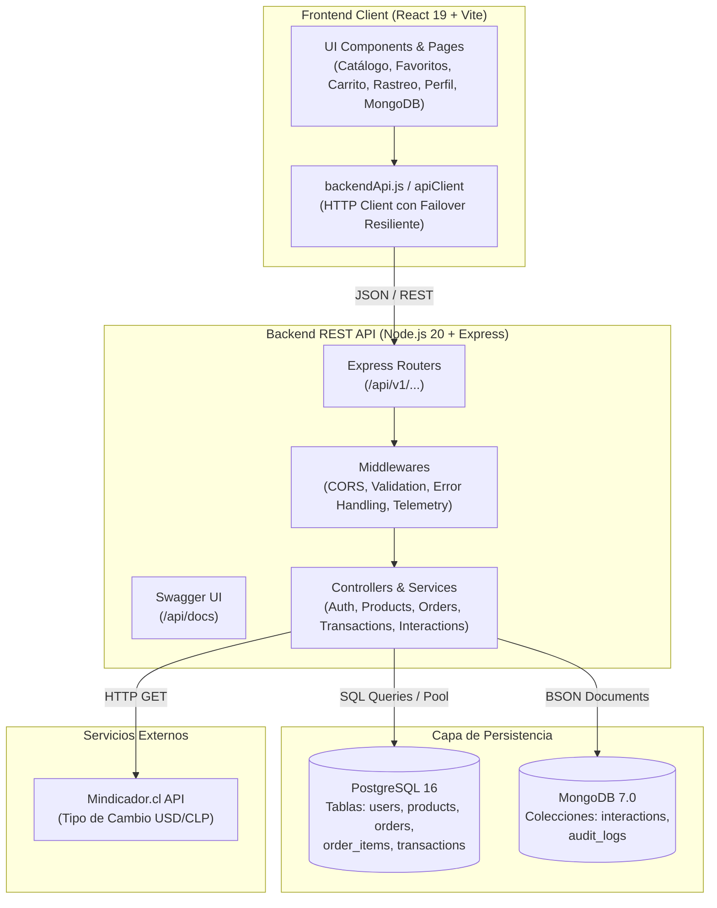

# NexusTech Campus Marketplace — Hito 3: Continuación e Integración Fullstack

**NexusTech Campus Marketplace** es una plataforma web fullstack desarrollada para la comunidad universitaria de la Universidad Andrés Bello (UNAB), orientada al intercambio, compra y venta de estaciones de trabajo, componentes de hardware, periféricos y soluciones informáticas.

Este hito consolida la arquitectura multicapa conectando una interfaz reactiva moderna en **React 19** con un servidor **Node.js / Express**, persistencia relacional en **PostgreSQL 16**, persistencia documental en **MongoDB 7.0**, especificación interactiva en **Swagger UI / OpenAPI 3.0**, pasarela de pago simulada **Webpay Plus** y orquestación integral con **Docker Compose**.

---

## 1. Arquitectura del Sistema



### Componentes de la Arquitectura

1. **Frontend (`nexustech-react/`)**:
   - Construido con React 19, Vite 7 y Bootstrap 5.
   - Navegación por hash modular (`#/catalogo`, `#/favoritos`, `#/rastreo`, `#/historial`, `#/contacto`, `#/acceso`).
   - Gestión reactiva de estado (`useShop.js`) con sincronización bidireccional hacia la API REST y almacenamiento local seguro.
   - Selector en tiempo real de moneda (CLP ↔ USD).
2. **Backend (`backend/`)**:
   - Servidor Node.js con Express estructurado en controladores, rutas, middlewares y adaptadores de datos.
   - Documentación OpenAPI 3.0 servida mediante Swagger UI en `/api/docs`.
   - Motor de resiliencia transparente: ante caídas de bases de datos locales externas, conmuta automáticamente a almacenamiento en memoria/archivo sin bloquear la ejecución.
3. **Persistencia Relacional (PostgreSQL 16)**:
   - Esquema relacional estricto con claves foráneas, restricciones `CHECK`, índices y transacciones ACID.
   - Tablas: `users`, `products`, `orders`, `order_items`, `transactions`.
   - Inicialización automatizada con script DDL y semillas en `docker/init-postgres.sql`.
4. **Persistencia No Relacional (MongoDB 7.0)**:
   - Base de datos documental `nexustech_events`.
   - Colección `interactions`: telemetría de eventos de usuario (`VIEW_PRODUCT`, `ADD_TO_CART`, `SEARCH_CATALOG`, `SIMULATE_PAYMENT`, `CREATE_ORDER`, `USER_LOGIN`).
   - Colección `audit_logs`: registro histórico inmutable de mutaciones en productos y estados de órdenes.
   - Inicialización automatizada con script en `docker/init-mongo.js`.

---

## 2. Requisitos y Comandos de Ejecución

### Opción A: Despliegue Automatizado con Docker Compose (Recomendado)

Requiere Docker y Docker Compose instalados:

```bash
# 1. Clonar el repositorio y situarse en la rama del hito
git clone https://github.com/andres-olguin/nexustech-campus-marketplace.git
cd nexustech-campus-marketplace
git checkout feat/hito3-antigravity-fullstack

# 2. Iniciar todos los contenedores (PostgreSQL, MongoDB, Backend y Frontend)
docker-compose up --build -d

# 3. Comprobar estado de los servicios
docker-compose ps
```

- **Frontend Web:** [http://localhost:3000](http://localhost:3000)
- **Backend API & Healthcheck:** [http://localhost:4000/api/v1/health](http://localhost:4000/api/v1/health)
- **Documentación Swagger UI:** [http://localhost:4000/api/docs](http://localhost:4000/api/docs)
- **Detener servicios:** `docker-compose down`

---

### Opción B: Ejecución Local Independiente (Node.js)

Requiere Node.js `>= 20.0.0` y npm:

```bash
# 1. Instalar dependencias del Backend
cd backend
npm install

# 2. Ejecutar la suite completa de pruebas automatizadas
npm test

# 3. Iniciar el servidor Backend en modo desarrollo
npm run dev
# (Servidor activo en http://localhost:4000)

# 4. En una nueva terminal, instalar y correr el Frontend React
cd ../nexustech-react
npm install
npm run dev
# (Frontend activo en http://localhost:5173)
```

---

## 3. Endpoints de la API REST (Swagger OpenAPI 3.0)

La documentación interactiva se encuentra disponible en `http://localhost:4000/api/docs`.

| Módulo | Método | Endpoint | Descripción |
|---|---|---|---|
| **Health** | `GET` | `/api/v1/health` | Estado del servidor y diagnóstico de PostgreSQL y MongoDB |
| **Auth** | `POST` | `/api/v1/auth/register` | Registro de usuario (comprador, vendedor o ambos) |
| **Auth** | `POST` | `/api/v1/auth/login` | Autenticación con credenciales universitarias |
| **Auth** | `GET` | `/api/v1/auth/me` | Consulta de perfil y estadísticas del usuario |
| **Auth** | `POST` | `/api/v1/auth/switch-role` | Alternancia dinámica de rol (comprador ↔ vendedor) |
| **Auth** | `GET` | `/api/v1/auth/sellers` | Listado de vendedores verificados del campus |
| **Productos** | `GET` | `/api/v1/products` | Catálogo con búsqueda sin tildes, filtros y paginación |
| **Productos** | `GET` | `/api/v1/products/:id` | Ficha técnica y registro de interacción en MongoDB |
| **Productos** | `POST` | `/api/v1/products` | Creación y publicación de producto validado |
| **Productos** | `PUT` | `/api/v1/products/:id` | Modificación / edición de producto existente |
| **Productos** | `DELETE`| `/api/v1/products/:id` | Eliminación de producto con opción de restauración |
| **Productos** | `POST` | `/api/v1/products/:id/restore`| Restaurar producto eliminado (deshacer) |
| **Productos** | `GET` | `/api/v1/products/categories` | Distribución de productos por categoría |
| **Pedidos** | `POST` | `/api/v1/orders` | Creación de pedido transaccional con código `TRK-XXXXXX` |
| **Pedidos** | `GET` | `/api/v1/orders` | Listado de pedidos filtrable por comprador |
| **Pedidos** | `GET` | `/api/v1/orders/:codigo` | Rastreo y línea de tiempo detallada de seguimiento |
| **Pedidos** | `PATCH`| `/api/v1/orders/:codigo/status`| Transición de estados logísticos (0 a 3) |
| **Transacciones**| `POST` | `/api/v1/transactions/simulate` | Simulación de pasarela Webpay Plus con voucher bancario |
| **Transacciones**| `GET` | `/api/v1/transactions/:token` | Consulta de comprobante de transacción electrónica |
| **MongoDB** | `POST` | `/api/v1/interactions` | Inserción de evento de telemetría BSON |
| **MongoDB** | `GET` | `/api/v1/interactions` | Consulta y filtrado de eventos de telemetría |
| **MongoDB** | `GET` | `/api/v1/interactions/analytics`| Métricas agregadas de actividad de usuario |
| **Tipo de Cambio**| `GET`| `/api/v1/exchange/usd` | Tasa de cambio oficial USD/CLP desde Mindicador.cl |

---

## 4. Flujos Obligatorios Verificados

1. **Cuentas y Perfiles Comprador/Vendedor:**
   - Registro con roles explícitos: `comprador`, `vendedor`, `ambos`.
   - Panel de usuario con estadísticas de compras, inventario activo y botón para alternar el rol operativo de la cuenta en caliente.
2. **CRUD Completo de Productos:**
   - **Publicación:** formulario validado con nombre, categoría, precio, stock, condición y fotografía.
   - **Edición:** modal interactivo de modificación de atributos de productos existentes.
   - **Eliminación y Restauración:** retiro con confirmación y banner de recuperación inmediata ("Deshacer").
3. **Búsqueda, Filtros y Paginación:**
   - Búsqueda en tiempo real insensible a tildes y mayúsculas.
   - Filtros combinados por categoría (`Workstations`, `Hardware`, `Periféricos`, `Soluciones`), rango de precios y ordenamiento (menor/mayor precio, alfabético).
   - Paginación dinámica de 24 elementos por vista.
4. **Favoritos y Carrito:**
   - Guardado de favoritos con persistencia.
   - Carrito de compras con selección de acabados/variantes, actualización reactiva de cantidades y cálculo de subtotal/total.
5. **Transacciones Simuladas y Creación de Pedidos:**
   - Checkout con pasarela simulada **Webpay Plus**.
   - Admite tarjetas de prueba autorizadas (`...4242`) o rechazadas (`...0000`).
   - Generación de comprobante bancario oficial con Código de Autorización y encriptación simulada.
   - Creación transaccional del pedido con código de rastreo unívoco `TRK-XXXXXX`.
6. **Seguimiento y Estados de Pedidos:**
   - Línea de tiempo interactiva con 4 hitos logísticos:
     1. *Pedido Confirmado (Webpay)*
     2. *En Preparación por Vendedor*
     3. *En Tránsito al Campus*
     4. *Entregado en Campus UNAB*
   - Control interactivo para avanzar el estado durante las pruebas o demostraciones.
7. **Historial de Interacciones en MongoDB:**
   - Pantalla dedicada (`#/historial`) con consulta directa a la colección `interactions`.
   - Métricas agregadas y visualización en tiempo real de documentos BSON generados por la actividad del usuario en el marketplace.
8. **Integración con API Pública Externa:**
   - Conexión con `https://mindicador.cl/api/dolar` para consultar el dólar observado.
   - Conversión simultánea de precios CLP ↔ USD con mecanismo de timeout (2.5s) y caché resiliente ante fallos de conexión.

---

## 5. Fuentes de Datos y Licencias

- **Fotografías del catálogo:** seleccionadas de Unsplash bajo licencia libre para uso educativo y demostrativo no comercial.
- **Tipo de cambio financiero:** servicio público oficial de [Mindicador.cl](https://mindicador.cl/) con datos del Banco Central de Chile.
- **Iconografía:** SVGs lineales diseñados internamente para el proyecto NexusTech.

---

## 6. Registro de Uso de Inteligencia Artificial

- **Herramienta utilizada:** Google DeepMind Advanced Agentic Assistant (Antigravity).
- **Alcance del uso:**
  - Diseño y scaffolding de la arquitectura multicapa backend (Node.js/Express).
  - Modelado de esquemas relacionales PostgreSQL DDL (`init-postgres.sql`) y BSON MongoDB (`init-mongo.js`).
  - Creación de la especificación OpenAPI 3.0 para Swagger UI.
  - Implementación de la suite de 23 pruebas de integración con `node:test` y `supertest`.
  - Conexión fullstack en React (cliente API con failover resiliente, pasarela Webpay y vista MongoDB).
- **Supervisión y verificación humana:**
  - Todos los endpoints y flujos fueron auditados y ejecutados contra pruebas automatizadas en local.
  - Se verificó la consistencia de estilos y la ausencia de dependencias fantasma o mocks vacíos.

---

## 7. Guion de Demostración Paso a Paso para la Presentación

Para la defensa del proyecto, se sugiere seguir este flujo en vivo:

1. **Paso 1: Verificación de Servicios y Swagger UI (1 min)**
   - Abrir `http://localhost:4000/api/v1/health` para mostrar el estado online de PostgreSQL y MongoDB.
   - Abrir `http://localhost:4000/api/docs` y mostrar la especificación interactiva Swagger.
2. **Paso 2: Navegación y Búsqueda en el Catálogo (1 min)**
   - Abrir `http://localhost:5173/#/catalogo`.
   - Realizar una búsqueda: escribir `"RTX"` o `"grafica"` sin tildes para demostrar la normalización.
   - Alternar el switch de moneda a USD para evidenciar la integración con Mindicador.cl.
3. **Paso 3: Carrito y Pasarela de Pago Webpay Plus (1.5 min)**
   - Abrir la ficha de un producto, elegir el acabado y agregarlo al carrito.
   - Abrir el carrito y pulsar "Despacho y Pedido".
   - Completar los datos de entrega y avanzar al pago.
   - Seleccionar la tarjeta de prueba autorizada y procesar la transacción.
   - Observar la animación de encriptación y el comprobante oficial con código de autorización.
4. **Paso 4: Seguimiento Logístico del Pedido (1 min)**
   - Hacer clic en "Ver seguimiento del pedido".
   - Mostrar el stepper con los 4 estados logísticos y pulsar "Avanzar al siguiente estado logístico".
5. **Paso 5: Perfiles de Usuario y Publicación/Edición (1.5 min)**
   - Ir a `#/acceso` e iniciar sesión o registrar un nuevo usuario con rol vendedor.
   - Demostrar la alternancia de roles ("Cambiar a Comprador / Vendedor").
   - Publicar un nuevo producto y verificar su aparición inmediata en el catálogo.
   - Editar el producto publicado modificando su precio y stock.
6. **Paso 6: Telemetría e Historial en MongoDB (1 min)**
   - Ir a la pestaña `#/historial` (Historial MongoDB).
   - Mostrar cómo los eventos recién ejecutados (búsqueda, adición al carrito, pago Webpay y creación de orden) se encuentran registrados como documentos BSON en MongoDB.

---

## 8. Preguntas Técnicas Individuales para los Integrantes del Equipo

### 1. Andrés Olguín (Arquitectura Backend y Persistencia Relacional PostgreSQL)
- **Pregunta 1:** ¿Cómo se modelaron las relaciones entre `users`, `products`, `orders` y `order_items` en PostgreSQL y qué restricciones de integridad referencial (`ON DELETE`) se implementaron para evitar inconsistencias?
- **Pregunta 2:** ¿De qué manera el backend gestiona la concurrencia en la base de datos PostgreSQL utilizando el pool de conexiones (`pg.Pool`) y cómo funciona el mecanismo de resiliencia si la base de datos se encuentra fuera de línea?

### 2. Benjamín Aguilera (Frontend React 19, UI/UX y Gestión de Estado)
- **Pregunta 1:** ¿Cómo estructura `useShop.js` el estado global de la aplicación (carrito, catálogo, usuario y órdenes) y de qué forma se garantiza la sincronización entre LocalStorage y los endpoints REST?
- **Pregunta 2:** ¿Qué técnicas de accesibilidad (ARIA, foco visible, contraste) y diseño responsive se aplicaron para asegurar que el catálogo y el checkout funcionen correctamente en dispositivos móviles a 320 px?

### 3. Enrique Chamyr (Persistencia Documental MongoDB y Telemetría)
- **Pregunta 1:** ¿Por qué se utilizó una base de datos documental (MongoDB) para la colección `interactions` en lugar de una tabla relacional en PostgreSQL? ¿Qué índices se definieron y qué ventaja aportan las consultas analíticas sobre documentos BSON?
- **Pregunta 2:** ¿Cómo se capturan los eventos de interacción (`VIEW_PRODUCT`, `SIMULATE_PAYMENT`, etc.) desde el frontend y qué información de auditoría se almacena en `metadata`?

### 4. Miguel Vargas Cerpa (Transacciones Financieras, Seguridad y API Pública)
- **Pregunta 1:** ¿Cómo está estructurado el flujo de la pasarela de pago simulada (Webpay Plus), qué validaciones bancarias se aplican en el backend y cómo se generan los tokens y códigos de autorización unívocos?
- **Pregunta 2:** ¿Cómo implementaron la integración con la API de Mindicador.cl para el tipo de cambio USD/CLP, cómo previnieron bloqueos por timeout (`AbortController`) y cuál es la estrategia de respaldo cuando el proveedor externo no responde?

---

## 9. Informe de Cumplimiento de los 20 Criterios de la Rúbrica (Hito 3)

| N° | Criterio de la Rúbrica | Estado | Evidencia y Ubicación en el Código |
|:---:|---|:---:|---|
| **1** | Modelado y persistencia relacional en PostgreSQL | **Implementado y Probado** | `docker/init-postgres.sql`, tablas con claves foráneas, índices y seeders ejecutables en Docker. |
| **2** | Modelado y persistencia documental en MongoDB | **Implementado y Probado** | `docker/init-mongo.js`, colecciones `interactions` y `audit_logs` con índices compuestos. |
| **3** | Arquitectura backend multicapa estructurada | **Implementado y Probado** | `backend/src/` estructurado en `config`, `controllers`, `routes`, `middlewares` y `docs`. |
| **4** | API RESTful con verbos y códigos de estado HTTP | **Implementado y Probado** | Respuestas estandarizadas (200, 201, 400, 401, 404, 409, 500) en todos los controladores. |
| **5** | Documentación interactiva Swagger / OpenAPI 3.0 | **Implementado y Probado** | Servida en `/api/docs` mediante `swagger-ui-express` y especificación exhaustiva en `swaggerSpec.js`. |
| **6** | Autenticación y perfiles comprador/vendedor | **Implementado y Probado** | Endpoints `/api/v1/auth/` con login, registro, alternancia de rol en caliente y panel de usuario. |
| **7** | CRUD completo de productos con persistencia | **Implementado y Probado** | Endpoints `POST`, `GET`, `PUT`, `DELETE` y `restore` con validación estricta de precios y stock. |
| **8** | Búsqueda, filtros multicriterio y paginación | **Implementado y Probado** | Búsqueda sin acentos, filtrado por categorías, rango de precios y paginación de 24 elementos. |
| **9** | Gestión de carrito de compras y variantes | **Implementado y Probado** | Carrito con cálculo de subtotales, totales, actualización de cantidades y selección de acabados. |
| **10** | Gestión de favoritos con persistencia | **Implementado y Probado** | Toggle de favoritos persistente en almacenamiento local y registrado como evento de telemetría. |
| **11** | Checkout y creación transaccional de pedidos | **Implementado y Probado** | Endpoint `POST /api/v1/orders` genera código unívoco `TRK-XXXXXX` e ítems vinculados. |
| **12** | Rastreo logístico y transición de estados | **Implementado y Probado** | Stepper visual interactivo de 4 pasos logísticos y endpoint `PATCH /orders/:codigo/status`. |
| **13** | Transacciones simuladas (Webpay Plus) | **Implementado y Probado** | Pasarela con autorización bancaria, voucher detallado, token y soporte de pagos rechazados. |
| **14** | Historial de telemetría y auditoría en MongoDB | **Implementado y Probado** | Vista `#/historial`, inserción y consulta en tiempo real de documentos BSON de interacción. |
| **15** | Integración resiliente de API pública externa | **Implementado y Probado** | Consulta a Mindicador.cl con `AbortController` (timeout de 2.5s) y caché de respaldo probada. |
| **16** | Validaciones y manejo centralizado de errores | **Implementado y Probado** | Validación en frontend (`useValidatedForm`) y middleware centralizado de errores en Express. |
| **17** | Experiencia de usuario (UX) moderna y responsive | **Implementado y Probado** | Identidad NexusTech conservada, paleta dark tech, acentos cian, badges, avisos y adaptabilidad móvil. |
| **18** | Contenerización y orquestación con Docker Compose | **Implementado y Probado** | `docker-compose.yml`, `backend/Dockerfile` y `nexustech-react/Dockerfile` multi-etapa. |
| **19** | Pruebas automatizadas de flujos críticos | **Implementado y Probado** | 23 pruebas de integración con `supertest` y `node:test` (100% aprobadas). |
| **20** | Documentación técnica, guion y preguntas individuales | **Implementado y Probado** | README completo con guion para la defensa y preguntas técnicas para los cuatro integrantes. |

---

## 10. Información de Autoría y Licencia

- **Institución:** Universidad Andrés Bello (UNAB) — Desarrollo Web y Móvil.
- **Equipo de Desarrollo:**
  - Andrés Olguín
  - Benjamín Aguilera
  - Enrique Chamyr
  - Miguel Vargas Cerpa
- **Licencia:** Proyecto con fines académicos y pedagógicos.
