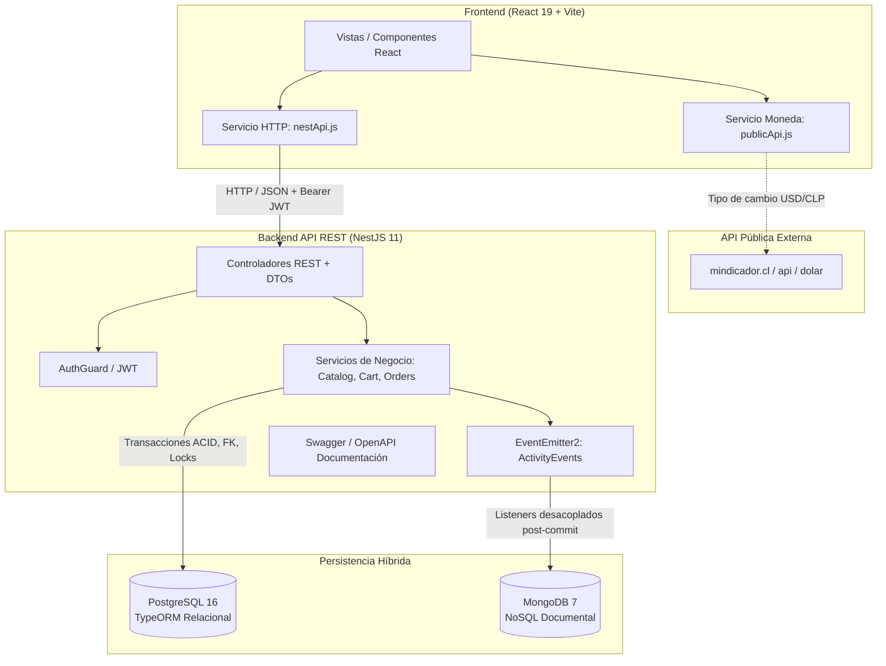

# NexusTech Campus Marketplace — Plataforma Web Full Stack (Hito 3)

Segundo Semestre 2026 · Asignatura: **Desarrollo Web y Móvil**  
Problemática seleccionada: **3.4 Marketplace universitario** (NexusTech Store / Campus Hub UNAB)

---

## 👥 Integrantes del Equipo

- **Andrés Olguín**
- **Miguel Margas**
- **Enrique Chamys**
- **Maximiliano Valdés**

---

## 📌 1. Descripción del Problema y Usuarios Objetivo

### Problemática
Los estudiantes de la comunidad universitaria no cuentan con un espacio seguro, estructurado y centralizado para comprar, vender o intercambiar artículos tecnológicos y académicos usados (laptops, calculadoras, periféricos, componentes de hardware, libros y apuntes). Actualmente, estas transacciones se realizan de manera informal y dispersa en redes sociales y grupos de mensajería (WhatsApp, Instagram), lo que genera:
- Desorden en la búsqueda de productos y falta de filtros técnicos.
- Incertidumbre sobre el estado real y stock disponible del producto.
- Falta de trazabilidad en los acuerdos de entrega entre comprador y vendedor.

### Usuarios Objetivo
1. **Estudiantes Compradores:** Alumnos que buscan adquirir tecnología y materiales académicos a precios accesibles dentro del campus, con estados de entrega verificables.
2. **Estudiantes Vendedores:** Alumnos que desean monetizar sus dispositivos o piezas en desuso mediante publicaciones ordenadas con control de stock e inventario.

---

## 🔄 2. Continuidad con Taller 2 y Funcionalidades de Expansión (Hito 3)

| Instancia | Enfoque | Resultado |
|---|---|---|
| **Taller 1** | HTML5, CSS3, Bootstrap y JS Vanilla nativo. | Prototipo web estático sin persistencia. |
| **Taller 2** | React 19, componentes modulares, estados locales y API pública de cambio. | Prototipo frontend interactivo. |
| **Hito 3** | Backend propio NestJS, PostgreSQL relacional, MongoDB NoSQL, Swagger y Docker Compose. | Plataforma web Full Stack integrada. |
| **Hito 4** | React Native consumiendo la misma API REST del Hito 3. | Extensión móvil. |

### Funcionalidades Obligatorias de Expansión Implementadas:
1. **Usuarios y perfiles:** Registro e inicio de sesión con JWT, perfiles diferenciados de comprador y vendedor (`/api/v1/users/me`).
2. **Publicación y administración de productos:** Creación, edición, consulta paginada, filtros técnicos y archivado lógico (`/api/v1/products`).
3. **Categorías, búsqueda y filtros:** Categorías administrables, búsqueda insensible a mayúsculas/acentos y filtros combinados por rango de precio.
4. **Favoritos y carrito:** Carrito y lista de deseos persistidos por usuario autenticado en base de datos (`/api/v1/cart`, `/api/v1/favorites`).
5. **Creación y seguimiento de pedidos:** Checkout transaccional con clave de idempotencia, descuento atómico de inventario y seguimiento multivendedor (`/api/v1/orders`, `/api/v1/seller/orders`).
6. **Estados de pedidos y transacciones simuladas:** Transiciones estrictas de fulfillment (`confirmed` → `preparing` → `shipped` → `delivered`), cancelación con reposición automática y comprobante de transacción simulada vinculada.
7. **Persistencia NoSQL complementaria:** Registro documental de eventos de auditoría y conversaciones/mensajes de interacción entre comprador y vendedor (`/api/v1/activity`).

---

## 🏗️ 3. Arquitectura y Diagrama de Componentes



---

## 🛠️ 4. Tecnologías y Versiones Principales

- **Frontend:** React 19, Vite 7, Bootstrap 5.3.
- **Backend:** NestJS 11, TypeScript 5.7 / 6, Node.js 22 LTS, Express platform.
- **Base de Datos Relacional (SQL):** PostgreSQL 16 + TypeORM 0.3 (Migraciones declarativas).
- **Base de Datos NoSQL:** MongoDB 7 + Driver oficial `mongodb` v6.
- **Seguridad:** JSON Web Tokens (`@nestjs/jwt`), hashing con `scrypt` + sal aleatoria criptográfica, Throttler (Rate Limiting) y Helmet.
- **Documentación de API:** Swagger / OpenAPI 3.0 (`@nestjs/swagger`).
- **Orquestación:** Docker y Docker Compose v2.

---

## 🗄️ 5. Modelo de Datos: SQL vs. NoSQL

### Modelo Relacional SQL (PostgreSQL)
Maneja las entidades transaccionales, estructuradas y con estricta integridad referencial:
- **`users`:** Identificadores únicos (UUID), credenciales con sal y fechas de registro.
- **`buyer_profiles` / `seller_profiles`:** Perfiles extendidos asociados por clave foránea al usuario.
- **`categories`:** Categorías de hardware/tecnología creadas en el sistema.
- **`products`:** Publicaciones con nombre, descripción, precio en CLP, stock, categoría (`FK`), vendedor (`FK`) y bandera de archivado lógico.
- **`cart_items` / `favorites`:** Items de carrito y favoritos vinculados a un usuario y producto.
- **`orders`:** Pedidos transaccionales con total del servidor, dirección de envío y clave de idempotencia.
- **`order_items`:** Detalle inmutable de los productos comprados (nombre histórico, cantidad y precio unitario congelado).
- **`order_fulfillments`:** Segmento de preparación declarado por cada vendedor independiente.
- **`simulated_transactions`:** Comprobante simulado vinculado al pedido con estado `approved` o `reversed`.

### Persistencia NoSQL (MongoDB) y su Justificación
El documento oficial del Hito 3 exige: *"NoSQL: conversaciones o historial de interacción"*.

**¿Por qué se justifica MongoDB y no es una duplicación de SQL?**
1. **Esquema flexible y polimórfico:** Los eventos de auditoría (`activity_logs`) contienen metadatos heterogéneos según la acción ejecutada (un cambio de fulfillment registra `sellerId`, `status` y `orderStatus`; una publicación registra categoría y precio; una interacción registra el texto libre de la pregunta). Modelar esto en SQL requeriría múltiples tablas dispersas o columnas JSONB sin tipado.
2. **Aislamiento y resiliencia transaccional:** La auditoría se publica mediante eventos asíncronos (`EventEmitter2`) **después del commit de la transacción SQL**. Si MongoDB experimenta alta latencia o indisponibilidad temporal, la compra en PostgreSQL no se revierte ni se corrompe.
3. **Colecciones creadas:**
   - `activity_logs`: Registro histórico de eventos (`product.created`, `order.created`, `order.cancelled`, `order.fulfillment.updated`).
   - `interactions`: Mensajes de consulta y preguntas entre estudiantes sobre productos o entregas.

---

## 📖 6. Descripción de la API y Acceso a Swagger

La API sigue las convenciones RESTful con prefijo unificado `/api/v1`. La documentación interactiva está expuesta mediante OpenAPI / Swagger UI:

- **URL de Swagger UI:** `http://localhost:3000/api/docs`
- **Endpoints Principales:**
  - `POST /api/v1/auth/register`, `POST /api/v1/auth/login`: Autenticación y emisión de JWT.
  - `GET /api/v1/users/me`: Perfil de usuario y roles.
  - `GET /api/v1/products`, `POST /api/v1/products`: Catálogo y publicaciones.
  - `GET /api/v1/cart`, `POST /api/v1/cart`: Carrito de compras.
  - `POST /api/v1/orders`: Checkout transaccional con validación de inventario.
  - `GET /api/v1/orders`, `PATCH /api/v1/orders/:id/status`: Seguimiento y cancelación de pedidos.
  - `PATCH /api/v1/seller/orders/:id/status`: Avance de fulfillment por vendedor.
  - `POST /api/v1/activity/interactions`, `GET /api/v1/activity/interactions/me`: Interacciones en MongoDB.
  - `GET /api/v1/activity/logs/me`: Historial de auditoría en MongoDB.
  - `GET /api/v1/health`: Verificación de salud y conectividad de bases de datos.

---

## 🌐 7. API Pública: Documentación y Justificación

- **API Consumida:** `mindicador.cl`
- **Endpoint:** `GET https://mindicador.cl/api/dolar`
- **Información que consume:** Tasa de cambio oficial del dólar estadounidense (USD) a pesos chilenos (CLP).
- **Dónde y por qué se utiliza:** En el catálogo y panel de precios (`ExchangeRatePanel.jsx`), permitiendo a los estudiantes visualizar estimaciones de precio en dólares para componentes importados, manteniendo el cobro transaccional en pesos chilenos (CLP).
- **Integración y Resiliencia:** Se consume desde el frontend mediante un servicio HTTP dedicado ([`publicApi.js`](nexustech-react/src/services/publicApi.js)) con almacenamiento en caché local (`localStorage`) de hasta 30 minutos, manejo estricto de estados de carga, reintentos y tolerancia a fallos sin inventar valores ficticios.

---

## 🐳 8. Instrucciones de Configuración y Ejecución con Docker Compose

### Requisitos Previos
- Docker Desktop instalado y en ejecución.
- Git.

### Puesta en Marcha con un solo comando:

```bash
# 1. Clonar el repositorio y entrar en el proyecto
cd nexustech-campus-marketplace

# 2. Copiar el archivo de variables de entorno
cp .env.example .env

# 3. Levantar todos los servicios con Docker Compose
docker compose up --build
```

### Servicios y Puertos Disponibles:
| Servicio | Contenedor | Puerto Local | Descripción |
|---|---|---|---|
| **Frontend** | `nexustech-frontend` | `http://localhost:5173` | Aplicación React servida por Nginx. |
| **Backend** | `nexustech-backend` | `http://localhost:3000` | API REST NestJS y Swagger. |
| **Swagger** | `nexustech-backend` | `http://localhost:3000/api/docs` | Explorador interactivo OpenAPI. |
| **PostgreSQL** | `nexustech-postgres` | `localhost:5432` | Base de datos relacional. |
| **MongoDB** | `nexustech-mongodb` | `localhost:27017` | Base de datos documental NoSQL. |

---

## ⚙️ 9. Variables de Entorno (`.env.example`)

El repositorio incluye un archivo de plantilla [`.env.example`](.env.example) sin credenciales reales:
```env
PORT=3000
CORS_ORIGINS=http://localhost:5173,http://localhost:80,http://localhost:3000
JWT_SECRET=reemplazar_con_clave_secreta_de_al_menos_32_caracteres_aleatorios
DATABASE_HOST=localhost
DATABASE_PORT=5432
DATABASE_USER=nexustech
DATABASE_PASSWORD=reemplazar_con_contraseña_segura
DATABASE_NAME=nexustech
MONGODB_URI=mongodb://localhost:27017/nexustech
MONGODB_DB_NAME=nexustech
VITE_API_BASE_URL=http://localhost:3000/api/v1
```

---

## 🧪 10. Pruebas y Limitaciones Conocidas

- **Pruebas Automatizadas:**
  - Backend: Pruebas unitarias y de integración contra base de datos aislada (`backend/test/marketplace.test.cjs`, `backend/test/activity.test.cjs`).
  - Frontend: Pruebas de integración E2E con Playwright (`nexustech-react/test/browser/marketplace.spec.js`).
- **Limitaciones Conocidas:**
  - Los pagos son simulados (`provider: simulation`); no se integran pasarelas bancarias reales ni cobros comerciales.
  - La auditoría en MongoDB opera bajo semántica *best-effort* tras el commit de SQL (no bloquea compras en caso de falla de red en Mongo).

---

## 🤖 11. Uso Responsable de Inteligencia Artificial

De acuerdo con lo exigido en la **Sección 10** del documento de evaluación, se reporta el uso de herramientas de IA durante el desarrollo:

| Herramienta | Propósito | Prompt representativo | Resultado | Validación humana | Aprendizaje |
|---|---|---|---|---|---|
| **Google Antigravity (Gemini 3.8)** | Análisis de requerimientos y auditoría de duplicados | *"Revisar este repositorio, eliminar cualquier documento repetido y reportar qué falta hacer en relación al documento del Hito 3."* | Identificación de clones redundantes, eliminación de archivos `(1).html` y matriz de brechas de persistencia NoSQL. | Se validaron los hashes SHA-256 de archivos antes de su eliminación física y se cotejó la pauta del Hito 3. | Importancia de auditar ramas remotas y limpiar artefactos de descarga previa antes de integrar. |
| **OpenAI Codex** | Scaffold de backend NestJS y TypeORM | *"Generar data-source TypeORM con migraciones reversibles y entidades SQL con claves foráneas para marketplace."* | Estructura modular de NestJS, migraciones y esquemas OpenAPI. | Se verificó que las contraseñas usen scrypt con sal y que los DTOs restrinjan los límites de stock y precio. | Las transacciones de checkout requieren locks pesimistas para evitar condiciones de carrera por stock concurrente. |
| **Google Antigravity** | Módulo NoSQL e integración Docker Compose | *"Implementar módulo ActivityModule en NestJS para persistencia en MongoDB y orquestar Docker Compose."* | Módulo `backend/src/activity/`, controladores de interacción y configuración multicontenedor. | Se aseguró que las fallas de conexión a MongoDB no rompan las transacciones atómicas de PostgreSQL. | El patrón de eventos asíncronos post-commit garantiza desacoplamiento entre el núcleo transaccional SQL y la auditoría NoSQL. |
