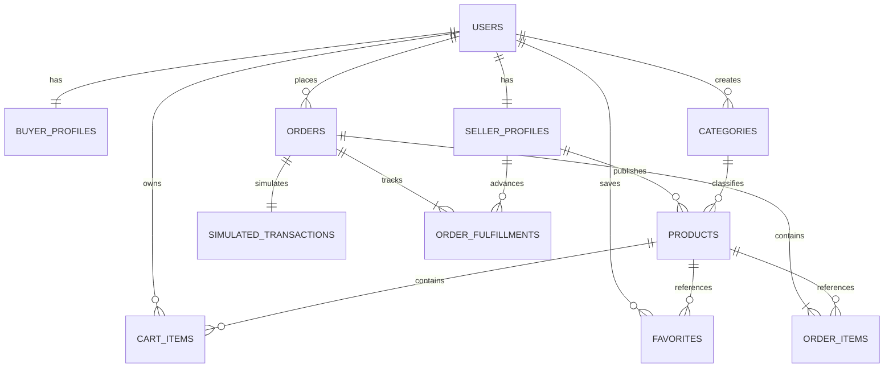

# NexusTech — Backend Hito 3

API NestJS 11, TypeScript, TypeORM y PostgreSQL. Mantiene el marketplace de tecnología para la comunidad estudiantil: catálogo, publicaciones, comprador/vendedor, favoritos, carrito y pedidos con transacciones **simuladas**.

Backend canónico para el Hito 3: PR #4. La variante Express de `2a9a76d` no se integra en este directorio. Ver [revisión del conflicto](../docs/hito3/BACKEND_CONFLICT_REVIEW.md), [guía React](../docs/hito3/FRONTEND_INTEGRATION_GUIDE.md), [contrato Mongo](../docs/hito3/ACTIVITY_INTEGRATION.md) y [demostración aislada](DEMO_PROCEDURE.md).

## Arranque

Requisitos: Node.js >=22.12, npm y PostgreSQL 16 o superior. Verificado en Windows con Node 26.13 y PostgreSQL 18.6. No se requiere MongoDB para ejecutar este backend. No se modificó Docker Compose.

Desde `backend/`, en PowerShell:

```powershell
npm ci
Copy-Item .env.example .env
# Editar .env con la conexión real de PostgreSQL y un JWT_SECRET aleatorio.
# Generar un secreto: node -e "console.log(require('crypto').randomBytes(48).toString('hex'))"
npm run migration:run
npm run build
npm start
```

Crear previamente la base y un usuario con permisos de conexión y creación de tablas. La migración usa `pgcrypto` y `gen_random_uuid()`; el usuario de migraciones debe tener los permisos necesarios para instalar la extensión si no existe. No usar el superusuario de las pruebas para producción.

Conexión: definir `DATABASE_URL` o las variables `DATABASE_HOST`, `DATABASE_PORT`, `DATABASE_USER`, `DATABASE_PASSWORD`, `DATABASE_NAME`. `DATABASE_URL` tiene precedencia; evitar mezclar ambas modalidades. `JWT_SECRET` es obligatorio, mínimo 32 bytes, sin valor de respaldo. `.env` está ignorado por Git; `.env.example` no contiene credenciales.

API: `http://localhost:3000/api/v1`. Swagger interactivo: `http://localhost:3000/docs`. OpenAPI JSON: `http://localhost:3000/docs-json`. CORS acepta por defecto `http://localhost:5173`; `CORS_ORIGINS` permite una lista separada por comas. `PORT` cambia el puerto.

## Flujo demostrable

1. `POST /auth/register` para vendedor y comprador, con correos sintéticos distintos y contraseña de 12..128 caracteres. La respuesta contiene `accessToken`.
2. En Swagger, pulsar **Authorize** e ingresar el token del vendedor.
3. `POST /categories` con `{"name":"Hardware"}`.
4. `POST /products` con categoría UUID, nombre, descripción, precio entero CLP y stock. Ejemplo completo en el [contrato](../docs/hito3/api-contract.md).
5. Autorizar al comprador. `PUT /cart` con `{"productId":"UUID","quantity":1}`.
6. `POST /orders` con `{"shippingAddress":"Retiro campus principal","idempotencyKey":"demo-checkout-001"}`.
7. Consultar pedido y producto: el pedido conserva nombre/precio y el stock disminuye. Repetir con la misma clave devuelve el mismo pedido.
8. `PATCH /orders/UUID/status` con `{"status":"cancelled"}` repone stock y revierte la transacción simulada. Una segunda cancelación devuelve 409.

Los tokens deben enviarse en `Authorization: Bearer TOKEN`. El ID del usuario se obtiene exclusivamente del JWT. Los IDs del catálogo del Taller 2 no se reutilizan: el frontend debe consumir los UUID del backend y adaptar nombres de campos a camelCase en inglés.

## Arquitectura y modelo

`src/main.ts` inicia la aplicación; `bootstrap.ts` configura validación estricta, errores, CORS, Helmet y Swagger. `app.module.ts` registra controladores, servicios y dependencias. Cada dominio separa controladores HTTP y servicios de negocio en `auth/`, `catalog/`, `users/`, `cart/` y `orders/`. `common/dto.ts` contiene entradas validadas; `common/openapi.ts` describe respuestas, sin exponer entidades sensibles. `database/` contiene entidades TypeORM, configuración y migraciones SQL.



Una publicación es la oferta vendible del producto; no hay una segunda tabla que duplique precio o stock. El carrito es el conjunto de elementos de un usuario, con máximo 100 productos diferentes. Cada cuenta tiene perfiles comprador y vendedor. Categorías son administradas por su creador; solo se borran sin productos asociados. Los productos se archivan para preservar referencias e historial. El estado inicial del pedido es `confirmed`, con transacción `approved` del proveedor `simulation`; no representa un cobro.

La integridad relacional está declarada en la migración SQL mediante FK, UNIQUE y CHECK; TypeORM conserva las claves UUID explícitas y los servicios consultan relaciones sin carga implícita. `synchronize` y migraciones automáticas al arrancar están desactivados. Ejecutar migraciones como etapa de despliegue previa al servidor.

Checkout usa transacción SQL y bloquea primero el usuario (mismo bloqueo que modificaciones del carrito) y luego los productos en orden UUID. Verifica todos los elementos antes de escribir; crea pedido/detalles/transacción, descuenta stock y vacía carrito de forma atómica. La clave de idempotencia es única por usuario. Una clave con otra dirección devuelve 409; una clave ya procesada devuelve el pedido original, incluso cancelado. Usar una clave nueva para una compra nueva. Cancelar bloquea pedido y productos, comprueba estado y repone una sola vez. Si la reposición supera 100000 unidades, devuelve 409 y revierte toda la cancelación; debe corregirse inventario antes de reintentar.

Cada pedido incorpora `order_fulfillments`, uno por vendedor, y sellerId histórico en cada detalle. `GET /seller/orders` muestra solo artículos propios y destino necesario; `PATCH /seller/orders/:id/status` permite confirmed→preparing→shipped→delivered, solo al vendedor participante y sin saltos. El agregado es el menor avance entre vendedores. El comprador solo puede cancelar si **todos** siguen confirmed, aunque el agregado aún sea confirmed. Las transiciones y cancelación comparten bloqueo del pedido; avanzar no altera inventario ni la transacción simulada. Los estados son declaraciones para la demostración, sin conexión con transportistas ni prueba real de entrega.

## Migraciones

```powershell
npm run migration:run
npm run migration:revert
# En despliegue con JavaScript compilado:
npm run build
npm run migration:run:prod
```

La reversión inicial elimina tablas y datos del backend; usarla solo en una base de prueba o con respaldo y autorización operativa. La primera migración crea diez tablas y sus restricciones/índices. La segunda agrega seguimiento por vendedor y completa datos históricos desde los productos referenciados: once tablas en total. Su reversión se rechaza si ya existe seguimiento avanzado para no borrarlo silenciosamente. Añadir migraciones nuevas para cambios posteriores: no editar las aplicadas en una base compartida. La extensión pgcrypto no se elimina al revertir para no afectar consumidores externos.

## Pruebas reproducibles

```powershell
npm test
npm audit
```

`npm test` compila y ejecuta pruebas HTTP con Supertest contra un proceso **real** PostgreSQL aislado mediante `embedded-postgres` (dependencia de desarrollo). Usa el puerto 55439, directorio temporal, credenciales aleatorias y base `nexustech_test`; no utiliza ni borra la base de `.env`. Detiene el proceso y elimina su cluster al terminar. Requiere que el puerto esté libre, binarios compatibles con el sistema y permiso para ejecutar procesos locales. No crear usuarios del sistema ni ejecutar como root en Linux; usar un usuario normal. No es un simulador SQL ni una prueba de conexión al entorno de despliegue.

Se verifican CLIs de migración TypeScript/producción, salud SQL, esquemas Swagger, validaciones, JWT, perfiles, propiedad, claves foráneas, filtros combinados, favoritos, carrito, checkout concurrente/idempotente, competencia por última unidad, rollback de una compra fallida y cancelación concurrente. También seguimiento multivendedor, permisos y aislamiento de eventos fallidos, carrera cancelación/preparación y persistencia tras reiniciar PostgreSQL y dos procesos API. Requiere puertos 55439 y 55440 disponibles. La suite no prueba React, Docker Compose ni MongoDB.

El lockfile fija las versiones. Overrides de `glob` y `minimatch` corrigen avisos transitivos de la línea TypeORM 0.3. Las migraciones se registran explícitamente, sin patrones glob. Ver [VALIDATION.md](VALIDATION.md) para la fase inicial y [PHASE2_REPORT.md](PHASE2_REPORT.md) para esta fase de integración y cierre.

## Seguridad y errores

JWT HS256 con issuer/audience y expiración de una hora; hashes scrypt con sal aleatoria y comparación en tiempo constante. No se exponen hashes en respuestas. Validación de propiedad para productos, categorías, carrito, favoritos y pedidos. Las entradas rechazan propiedades extra. Consultas parametrizadas, stock/precios/cantidades acotados y restricciones SQL. Helmet y límite global de 120 solicitudes/minuto/IP; autenticación: 10/minuto/IP por endpoint. Rate limit en memoria: no coordina múltiples instancias. No se confía en cabeceras proxy arbitrarias.

Formato de error: `{statusCode,message,error}`. Validación 400; credenciales 401; propiedad 403; recurso 404; integridad/stock/estado 409; rate limit 429; error interno 500 sin detalles SQL; salud SQL 503. Los detalles de errores inesperados se registran solo en servidor. No registrar tokens, contraseñas ni cuerpos con datos personales. Asegurar HTTPS, secretos y permisos mínimos de base de datos en el despliegue.

Alcance académico: sin recuperación de contraseña, verificación de correo, MFA, refresh tokens ni revocación inmediata. No hay pagos reales, envíos reales ni validación de pertenencia institucional. No se afirma que esta implementación sea una plataforma comercial lista para producción.

## Integración reservada de actividad

No se crea ni modifica `src/activity/`. El otro agente debe exportar `ActivityModule` y agregarlo a `imports` de `AppModule`, con sus propias dependencias y `MONGODB_URI`. `EventEmitterModule` ya está registrado. Suscribirse mediante `@OnEvent('order.created')` (o los otros eventos del contrato) y usar exclusivamente `{userId,resourceId,occurredAt}`. `ActivityEvents` publica después del commit y aísla excepciones/rechazos de listeners; una falla Mongo no cambia el resultado SQL. Entrega best effort: no hay cola persistente, outbox ni reintentos garantizados.

## Fuentes y uso de IA

Implementación asistida por Codex a partir de los requisitos del Hito 3 y el catálogo existente. La IA propuso contrato, esquema, controladores, servicios, documentación y pruebas; las afirmaciones de funcionamiento se limitan a comandos ejecutados y resultados registrados. No se modificaron frontend ni archivos de infraestructura ni el módulo reservado.

Referencias primarias: [validación NestJS](https://docs.nestjs.com/techniques/validation), [OpenAPI NestJS](https://docs.nestjs.com/openapi/introduction), [JWT NestJS](https://github.com/nestjs/jwt), [transacciones TypeORM](https://typeorm.io/docs/advanced-topics/transactions/), [bloqueos PostgreSQL](https://www.postgresql.org/docs/current/explicit-locking.html), [scrypt Node.js](https://nodejs.org/api/crypto.html#cryptoscryptpassword-salt-keylen-options-callback), [embedded-postgres](https://github.com/leinelissen/embedded-postgres).
